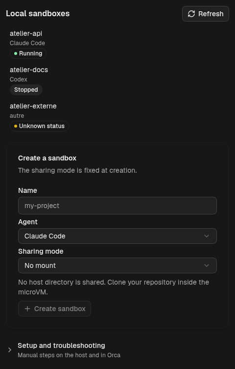

# Docker Sandboxes

Manage local Docker microVMs from Orca and open your projects over SSH. The panel lists, creates, and stops sandboxes. Multiple worktrees can share a single reusable microVM.



## Installation

### Install a tagged version from GitHub

1. Open **Settings → Plugins** in **Orca Desktop 1.4.247 or later**. Turn on plugins if needed.
2. Choose **Install from Git** and enter `https://github.com/semhoun/orca-docker-sandboxes.git#v1.0.0`.
3. Review the requested access before approving the installation. This plugin runs a trusted worker on the Orca host with your user permissions.

If you use the Orca CLI, you can install the same tag from any directory:

```sh
orca plugin install semhoun/orca-docker-sandboxes@v1.0.0
```

The CLI prints the exact command to rerun with `--approve` and the installation fingerprint. Review the requested access before rerunning it. Both methods install the exact commit referenced by the tag. The tag must exist on GitHub; no manual clone or GitHub Release is required.

### Set up Docker Sandboxes

Make sure **`sbx` 0.48.0 or later** and the OpenSSH client (`ssh`) are on the host's `PATH`. The two modes that use a local repository also require Git (`git`) on the host.

Follow the [Docker Sandboxes installation guide](https://docs.docker.com/ai/sandboxes/install/) to set up local virtualization (KVM on Linux). `sbx` requires neither Docker Desktop nor Docker Engine. This plugin guide targets Linux. The availability of `sbx` on macOS and Windows does not establish plugin compatibility on those platforms.

1. Sign in to Docker on the host:

   ```sh
   sbx login
   ```

2. In Docker Sandboxes, configure credentials for your chosen agent and a network policy suited to your project. Then set up SSH access on the host once:

   ```sh
   sbx setup ssh
   ```

## Quick start

The panel follows Orca's interface language: French for French locales and English otherwise. The steps below use the English labels.

1. Open the **Docker Sandboxes** panel. In **Create a sandbox**, enter `my-project`, select **Claude Code** or **Codex**, then choose **Clone local repository**. Enter the absolute path to the root of a demo repository's primary Git checkout and click **Create sandbox**.
2. Open the details for `my-project` in the list and click **Test SSH**. The panel shows the remote directory if it finds one. OpenSSH can respond even when the panel cannot identify a usable checkout.
3. In **Settings → SSH → Add Target**, enter `my-project.sbx` as the host and `_default_user_` as the username. Keep the default port and leave the identity file blank, then click **Test** and **Save**.
4. Add the existing repository on that SSH target. Open the **writable clone inside the microVM**, not `/run/sandbox/source`, which exposes the host source as read-only. If the panel did not find a usable directory, locate the clone in the sandbox before adding the repository.
5. Create a worktree and choose `my-project.sbx` under **Run on**. This also works in **No mount** mode, after you clone the repository inside the microVM.

Orca installs its remote runtime on the first connection and launches the agent installed in the template when you start it. The panel does neither. See [Docker's guide to connecting Orca](https://docs.docker.com/ai/sandboxes/integrations/orca/).

## Sharing modes

The sharing mode is fixed when you create the sandbox. For either mode that takes a local path, use the root of the primary Git checkout, not a linked worktree.

| Mode | What is shared and how to use it |
| --- | --- |
| **No mount** | No host directory is shared. Clone the repository inside the microVM, usually under `/home/agent/workspace`. |
| **Clone local repository** | Docker creates a writable copy inside the microVM. The host source remains available as read-only. Git may add a remote named `sandbox-<name>`. |
| **Direct mount** | Writes to the mounted directory modify the host checkout. Review the displayed path and explicitly confirm the mount, then open the existing checkout over SSH. |

Choose **No mount** or **Clone local repository** to create worktrees independently of the host checkout. Worktrees in the same sandbox share its tools, network, and services.

## Access and troubleshooting

The **panel** shows sandbox status and SSH connection details. It does not change SSH settings or credentials. The **trusted worker** runs management commands on the host, outside the microVM and with your user permissions, even with `capabilities: []`. The **microVM** hosts the remote runtime and the agent. Sandbox management is local, but the microVM's network access depends on the Docker network policy you choose.

- **Stale list:** Click **Refresh** before taking action. If an action wasn't confirmed, check the displayed status before retrying it.
- **SSH failure:** Check `sbx login` and `sbx setup ssh` without disabling host key verification. **Test SSH** uses OpenSSH and can start a stopped sandbox. It does not validate Orca's remote runtime. If OpenSSH responds but Orca fails, use **Test** in **Settings → SSH**.
- **Stopping:** **Stop** is unavailable if Docker does not provide a stable ID, while the sandbox is starting or stopping, or if it is already stopped. Stopping preserves files but interrupts agents and terminal sessions. To keep the sandbox stopped, disable **Reconnect on launch** on its SSH target: reconnecting can start it again.
- **Deleting:** The panel does not delete sandboxes. Export your changes first, for example through Git. Then run `sbx rm <name>` in a terminal and review Docker's confirmation prompt. Any files inside the sandbox that you did not export will be lost. Remove the obsolete SSH target from Orca afterward.

## Development

To develop the plugin, clone the repository and run `orca plugin dev load .` from the clone root with Orca Desktop open and plugins enabled. Review the requested access and follow the CLI's approval instructions. Orca loads the TypeScript files directly; no npm install or build step is needed.

From the plugin root, run `orca plugin types .` if `.orca/types/` is missing, then run the checks:

```sh
orca plugin validate .
orca plugin check .
orca plugin test .
```

`validate` checks the manifest, `check` also renders the panel scenarios, and `test` runs the test suite. The tests require neither Docker nor SSH, but the subprocess smoke test uses Git. See [AGENTS.md](AGENTS.md) for project-specific details and the [Orca plugin authoring guide](https://github.com/stablyai/orca/blob/main/docs/reference/plugin-authoring.md?plain=1) for reference.

## License

[MIT](LICENSE).
